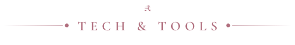
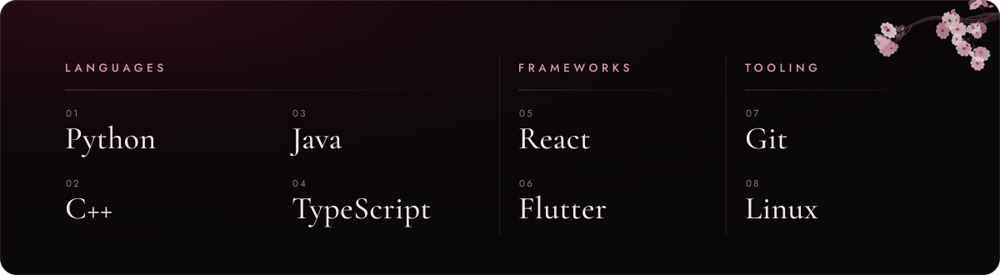
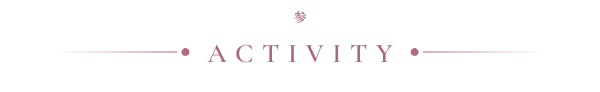
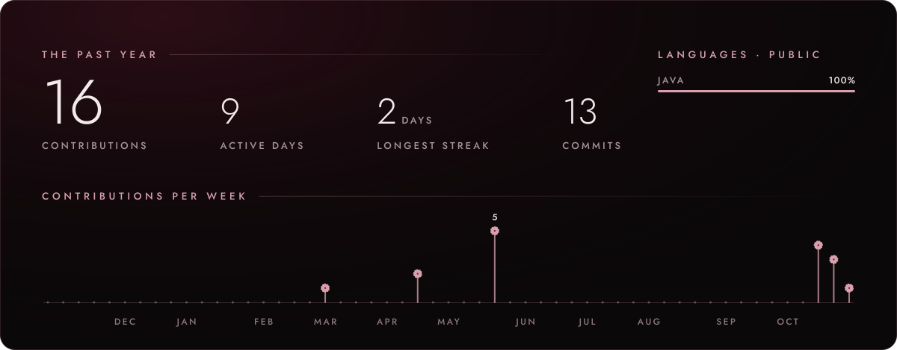

<!--
  Artwork lives in assets/ (original SVG, no external assets).
  assets/activity*.svg is regenerated daily by .github/workflows/activity.yml.
-->

  <picture>
    <source media="(max-width: 600px)" srcset="assets/hero-mobile.svg">
    
  </picture>

 

<h3 align="center">
  <picture></picture>
</h3>

  Software Engineering student drawn to <b>intelligent systems</b>, <b>modern software</b> and <b>digital design</b>.
   
  I like software that feels intentional: clean structure, thoughtful interfaces and a real purpose.

  CURRENTLY EXPLORING&ensp;·&ensp;AI-DRIVEN PRODUCTS&ensp;·&ensp;INTERFACE DESIGN&ensp;·&ensp;DESKTOP &amp; MOBILE APPS

 

<h3 align="center">
  <picture></picture>
</h3>

  <picture>
    <source media="(max-width: 600px)" srcset="assets/tools-mobile.svg">
    
  </picture>

 

<h3 align="center">
  <picture></picture>
</h3>

  <picture>
    <source media="(max-width: 600px)" srcset="assets/activity-mobile.svg">
    
  </picture>
   
  Rendered daily from public GitHub data by a workflow in this repository.

 

  <picture></picture>

  <picture>
    <source media="(max-width: 600px)" srcset="assets/signature-mobile.svg">
    
  </picture>

